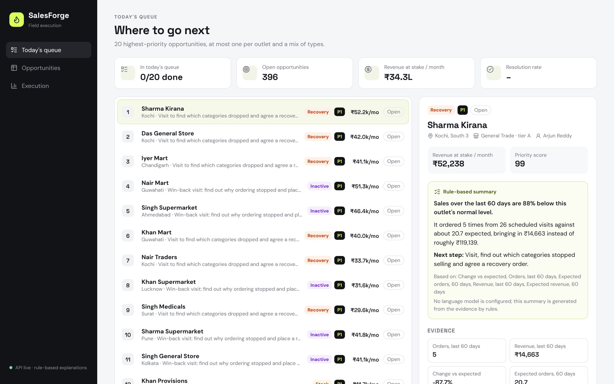
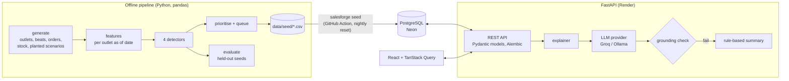

# SalesForge

[](https://github.com/AtishayKashyap/AI-Powered-Sales-Execution-Opportunity-Intelligence-Platform/actions/workflows/ci.yml)

Sales-execution intelligence for a consumer-goods distributor's field team. A data pipeline finds four kinds of
opportunity across 2,000 retail outlets, prioritises them by severity and revenue at stake, and builds a daily
queue for reps. Reps see the evidence and a plain-language explanation for each opportunity, then log what they
did and how it went.

**Live demo:** https://salesforge-frontend.onrender.com (free tier: the first load after a quiet spell can take a
minute while the API wakes up)



## What it does

| Opportunity | Detected when | Value at stake |
|---|---|---|
| **Revenue Recovery** | 60-day revenue at least 35% below the outlet's seasonally adjusted baseline, *and* a binomial test on orders per scheduled visit gives p <= 0.01 | the monthly shortfall |
| **Inactive Outlet** | a regular buyer (2+ orders a month) has not ordered for 30+ days | its usual monthly revenue |
| **Stock Risk** | shelf empty on 8%+ of the last 90 days | revenue lost at that rate |
| **Cross-Sell** | an active outlet lacks a category that 90%+ of similar nearby outlets stock | the peers' median monthly sales of it |

**Priority** is half severity and half revenue at stake (as a percentile), banded P1-P3. **Today's queue** takes the
20 highest priorities with at most one per outlet and a cap per type, so a rep's day is not five visits for the same
problem.

**Held-out accuracy** (thresholds tuned on one simulated year, scored on four others; details in
[docs/EVALUATION.md](docs/EVALUATION.md)):

| Detector | Precision | Recall |
|---|---:|---:|
| Stock Risk | 0.96 | 0.91 |
| Revenue Recovery | 0.78 | 0.68 |
| Cross-Sell | 0.74 | 0.72 |
| Inactive Outlet | 1.00 | 1.00 |

## Explanations that cannot invent facts

Each opportunity gets a short explanation for the rep. With an LLM configured (Groq's free tier by default, or a
local model through Ollama), the model gets the evidence and returns structured JSON. Then a **grounding check**
verifies it before anyone sees it:

- every number must equal an evidence value, a rounding of one, or a ratio or change between two evidence values
  **of the same kind** (rupees with rupees, never days with rupees);
- units must match: a percentage claim needs a percentage field, a ₹ claim a money field;
- number words and multipliers are parsed ("seven in ten", "doubled", "3x");
- a product category may be mentioned only if it is the one in the evidence;
- `evidence_used` must name real evidence fields.

A failed answer is retried once with the list of problems. If it fails again, or no model is configured, the app
shows a **rule-based summary** built from the evidence, and labels it as such. Only validated LLM answers are
cached. The test suite includes adversarial answers that must be rejected, such as "Snacks sales grew 3x and the
outlet has 7 competitors nearby" and "offer a 5 percent discount".

## Architecture



| Endpoint | Purpose |
|---|---|
| `GET /opportunities/queue` | today's 20, with status from the latest action |
| `GET /opportunities` | filter by type, priority, status; search outlet or city; paginated |
| `GET /opportunities/{id}` | detail with evidence and action history |
| `POST /opportunities/{id}/actions` | log a visit or call (assigned to the outlet's rep) |
| `PUT /actions/{id}/outcome` | record or correct the outcome; one per action, so counts never inflate |
| `GET /opportunities/{id}/explanation` | validated LLM explanation or rule-based summary |
| `GET /analytics/summary` | resolution rate by type, outcome mix, most active reps |

Interactive API docs are at `/docs` on the API.

## Run it

```bash
docker compose up --build        # Postgres, API on :8000, web on :5173
```

Or without Docker (Python 3.12+, Node 22, a local Postgres):

```bash
cd backend
python -m venv .venv && source .venv/bin/activate
pip install -r requirements-dev.txt
cp .env.example .env              # set DATABASE_URL; optionally LLM_PROVIDER and LLM_API_KEY
salesforge migrate && salesforge seed
uvicorn salesforge.main:app --reload

cd ../frontend && npm ci && npm run dev
```

`salesforge pipeline` regenerates `data/seed/` and the evaluation from scratch (about 40 s). Use `--seed` for
another simulated year.

## Tests

- **Backend:** 42 tests, 92% coverage, run against real PostgreSQL.
  - API behaviour: status lifecycle, outcome replacement, validation, rate limiting.
  - Grounding: adversarial answers rejected; every rule-based summary in the dataset passes.
  - Explainer: valid answers cached; one retry with feedback; fallback on failure.
  - Providers: mocked HTTP.
  - Pipeline: determinism; detectors never read the ground truth.
  - Migrations: they match the models, and downgrade and upgrade cleanly.
- **Frontend:** Vitest and Testing Library tests for the logging and outcome flow, error states and formatting.
- **CI:** ruff, mypy `--strict`, ESLint, TypeScript, both test suites, a production build, and a check that the
  committed seed data is exactly what the pipeline produces.

## Deploy (free)

1. **Neon:** create a project; copy the pooled and the direct connection strings.
2. **GitHub:** add the repository secret `DEMO_DATABASE_URL` (the direct string), then run *Reset demo data* from
   the Actions tab. It migrates and seeds, and repeats nightly so the public demo stays clean.
3. **Render:** deploy the blueprint (`render.yaml`). Set `DATABASE_URL` (pooled string) and optionally `LLM_API_KEY`
   (a free key from console.groq.com). Without a key the app runs with rule-based summaries.
4. *Keep demo warm* pings the API during Indian working hours, so the first visit does not wait for a cold start.

## Data

All outlets, reps and transactions are synthetic, generated by `backend/salesforge/pipeline/generate.py` with a
fixed seed. Amounts are Indian rupees.

MIT licensed.
